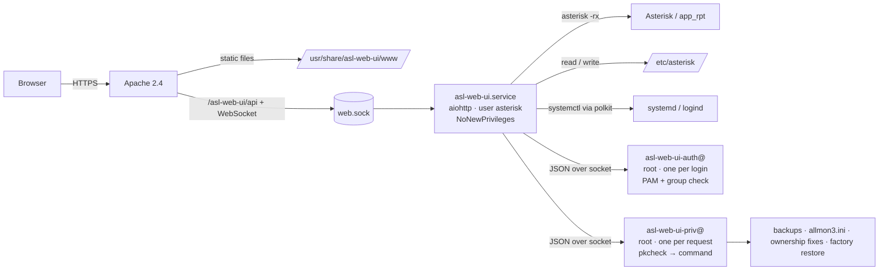

# asl-web-ui: Design

**Status:** awaiting approval · **Date:** 2026-10-14 · **Applies to:** phase 1

asl-web-ui is a web interface for managing an AllStarLink 3 node server. Phase 1
replaces the text menus in asl3-menu (`asl-menu`, `node-setup`, `asl-backup-menu`)
with a browser UI that looks and works like Cockpit. Later phases add Allmon3
management, scheduled tasks, and sound-file uploads.

This document describes the design as decided. The reasoning and the alternatives
behind each decision are in [design-notes.md](design-notes.md). Changes needed in
other AllStarLink packages are specified in [upstream-changes.md](upstream-changes.md).
A clickable mockup of every screen is published at
https://claude.ai/artifact/38FoRhoem3VfmuXvcbhEVD (source in [mockup/](mockup/)).

---

## 1. Requirements

| Requirement | How the design meets it |
|---|---|
| Everything asl3-menu does | Section 9 maps every menu item to a screen. |
| PatternFly, Cockpit look | React + PatternFly 6, a Cockpit-style shell |
| Runs behind Apache on Debian | Apache (or nginx) serves the frontend and proxies the API to a Unix socket. TLS stays in the web server. |
| Debian package with an ASL-style Makefile | Section 8 |
| Login with Linux accounts through PAM | A root auth helper runs the full PAM conversation, so MFA works through PAM configuration. |
| All actions run as `asterisk` | The web service runs as `asterisk`. Root actions go through polkit. |
| Root only through polkit; suid as last resort | A socket-activated root helper checks polkit for every request. No setuid binary is used. |
| Tolerate hand-edited `/etc/asterisk` | The config engine (section 5) |
| Safe on the Internet | Section 4 |
| Companion to Allmon3 | The same stack as Allmon3 (aiohttp). allmon3.ini is kept in sync. The module system leaves room for full Allmon3 management. |

## 2. Architecture

- **Frontend:** a single-page app in React, PatternFly 6 and TypeScript, bundled with
  esbuild. It holds no logic of its own; it displays what the API returns.
- **Backend:** Python with aiohttp and aiohttp-session, organized as **feature modules**.
  Each module registers its API routes, its navigation entries, the privileged
  commands it needs, and its background tasks.
  - Phase 1 modules: `core`, `system`, `asterisk`, `nodes`, `tuning`,
    `config_files`, `diagnostics`, `backups`.
  - Later modules: Allmon3, scheduling, sounds.
- **Talking to Asterisk:** `asterisk -rx` subprocesses through the control socket,
  with a concurrency limit, and a pseudo-terminal for interactive streams. AMI is
  not used.
- **API:**
  - REST/JSON under `/asl-web-ui/api/v1/`;
  - **one WebSocket per browser session** for job progress, live status, the
    restart-pending flag, and tuning streams;
  - **one WebSocket per terminal.**
- **Long-running operations** (restart, backup, restore, factory reset, the
  connectivity check) are jobs that report progress.
- **One shared status poller** (every 5–10 seconds, only while someone is connected)
  pushes registrations, service state, and restart-pending to every client.

## 3. Privilege model

| Action | Mechanism |
|---|---|
| Start, stop, restart `asterisk`, `allmon3`, `asl3-update-nodelist`; reboot; power off | `systemctl` called by the service. A shipped polkit rule allows only those units and only the asterisk user. |
| Create, restore, delete, import backups; edit the backup include list | `asl-web-ui-priv` commands |
| Factory restore (reinstall `asl3-asterisk-config`, keeping the AMI secret) | `asl-web-ui-priv`, with output streamed back |
| Edit `/etc/allmon3/allmon3.ini` | `asl-web-ui-priv file.write`. The path must be on an allowlist, and the hash is checked. The edit itself is computed without privilege. |
| Give root-owned files in `/etc/asterisk` back to the asterisk user | `asl-web-ui-priv asterisk.fix_ownership`. Only regular files under `/etc/asterisk`. |
| Everything else (config edits, AstDB, tuning, diagnostics) | No privilege needed: the service runs as `asterisk` |

How `asl-web-ui-priv` works:

- It is socket-activated, and a new process handles each request.
- It reads the caller's PID and UID from the socket, then runs
  `pkcheck --action-id org.allstarlink.asl-web-ui.<command> --process pid,start,uid`.
  `pkcheck` comes from `polkitd` and is not setuid.
- It has a fixed command table with typed arguments.
- It imports only the standard library, never the web app's code.

The web username is passed along for the audit log only. It is never used to
decide authorization. Admins can tighten the policy with their own polkit rules.

## 4. Security

- **Login**
  - The root auth helper speaks newline-delimited JSON. It relays each PAM prompt to
    the browser, so a password prompt followed by a TOTP prompt works without any
    change to the app.
  - It runs `pam_authenticate` and then `pam_acct_mgmt`, with `PAM_RHOST` set to
    the client address.
  - The user must be a member of the **`asl-web-ui`** group. Membership is checked
    again on **every request**, so removing someone from the group takes effect
    immediately.
  - Root cannot log in by default. No PAM session is opened.
- **Sessions**
  - Stored on the server, in memory. The cookie carries a random ID and is
    HttpOnly, SameSite=Strict and Secure.
  - "Keep me signed in" checked: sessions last 30 days, with a 7-day idle limit.
    Unchecked: 8 hours, with a 30-minute idle limit.
  - Restarting the service logs everyone out.
- **CSRF:** a token bound to the session, sent in a request header.
- **HTTPS required.** Over plain HTTP the login page explains why it refuses. The
  admin can allow HTTP with a documented setting, `allow_insecure_http`.
- **Re-authentication for destructive actions.** Reboot, shutdown, restore, factory
  reset, node removal, stopping Asterisk, changing the AMI secret, and fixing
  ownership all ask for the password again if it was last entered more than
  10 minutes ago.
- **Brute-force protection:** login attempts are slowed down per IP address and per
  user, and failures are logged in a fail2ban-friendly format.
- **Restore safety**
  - Only paths in the include list are extracted.
  - Absolute paths, `..`, and links that point outside those paths are rejected.
  - A snapshot is taken before anything is overwritten.
- **Apache headers:** strict Content-Security-Policy, `X-Frame-Options: DENY`,
  `Referrer-Policy`, `nosniff`. HSTS is documented for the admin's TLS virtual host.
- **No general shell.** The only terminals are the Asterisk console and the classic
  tune menu, both running as `asterisk`. The backup `--post-exec` hook is not
  exposed in the web UI.
- **Audit log:** `/var/lib/asl-web-ui/audit.jsonl` records who changed what, which
  files, the snapshot ID, and the result. The same entries go to journald with
  structured fields.

## 5. Configuration engine

This part of the design is what makes it safe to tolerate hand-edited files.

1. **Lossless file model.** Every line keeps its exact original bytes, and only
   changed lines are rewritten. Reading a file and writing it back unchanged
   produces identical bytes; this is tested against the whole test corpus. New lines
   copy the formatting of the lines around them.
2. **Asterisk's view of the files.** This layer reproduces how **ASL's patched
   Asterisk** reads configuration. Upstream Asterisk behaves differently, so it is
   not the reference.
   - Includes are expanded as text.
   - `#tryinclude` accepts globs and may match nothing.
   - Templates are copied at the moment a section header is read, so a template must
     be defined before it is used.
   - When a key is set more than once, the **last value wins**. Keys that may repeat
     keep every value.
   - Every effective value records where it came from.
3. **Intents, not text edits.** Guided pages ask for things like `set`, `unset`,
   `add_category`, `rename_category`, `set_templates`, `add_value`,
   `comment`/`uncomment`, or `set_module`. A planner turns each one into the
   smallest edit, in the file where the definition actually lives.
   - Guided pages never edit templates or the package's `custom/` files.
4. **Requirements per operation.** Each guided operation states what it needs. If a
   hand edit breaks that, only that operation is disabled, with the reason and a
   link to the offending line.
5. **Plan, then apply.** Every change follows the same steps:
   1. The planner returns diffs, warnings, and any requirement failures.
   2. The user confirms.
   3. The service takes a lock and checks that each file's hash still matches.
   4. It snapshots the files (`/var/lib/asl-web-ui/snapshots`).
   5. It writes temporary files and atomically renames them into place, keeping
      owner and mode.

   If a later file fails, the files already written are restored from the snapshot.
6. **Validation (lint).**
   - An **error** is something that can be shown, in the Asterisk or app_rpt source,
     to make Asterisk reject the file or stop a node from coming up, *and* that a
     test against real Asterisk confirms.
   - A **warning** is something Asterisk loads but ignores or overrides.
   - Each finding names its consequence and its source location.
   - Saving a file with errors asks for confirmation; it is not blocked.
7. **Check before restart or reload.** If `rpt.conf` has errors, every restart path
   and the console warn first, offering **Fix in editor** or **Run anyway**. The
   console warns before any command that reloads app_rpt. This matters because on
   app_rpt 3.10.5 a reload with an invalid `rpt.conf` disables every node, and the
   console still reports success. That behavior was confirmed by testing.
8. **Restart pending** is worked out from the files themselves: a configuration file
   modified after Asterisk started means a restart is pending. This catches edits
   made outside the web UI too.
9. **Specific behaviors that differ from node-setup**
   - **D1. A key set twice in a section:** the change goes to the line that is in
     effect. The preview offers to remove the redundant line.
   - **D2. Callsign change when `idrecording` isn't the simple `|iCALL` form:** the
     current value is shown, and the user decides whether to replace it.
   - **D3. AMI secret:** only the `[admin]` user's secret changes, and Allmon3 is
     updated to match. Other AMI users are listed and left alone.
   - **D4. "Enable customizations":** runs asl3-menu's
     `update-configuration-files.py` on a temporary copy. The result is shown as a
     diff and applied through the normal transaction.
   - **D5. Removing a node:** comments above its section are kept, unless they
     mention that node number.
   - **D6. Changing interface:** the old channel section is kept, so its tune
     settings survive a switch back.
10. **Other file formats.** `savenode.conf` (shell syntax) and `allmon3.ini` (INI)
    get lossless models of their own.

## 6. Screens

The shell looks like Cockpit: a dark top bar with the hostname, a restart-needed
indicator, help, and the user menu, and a dark navigation column on the left.

| Section | Contents |
|---|---|
| **Overview** | Health (from the cached connectivity check and basic checks), nodes, Asterisk (start, stop, restart), system (versions, **Reboot**, **Shut down**). First-run setup when only the template node 1999 exists. |
| **Nodes** | A table of nodes, and an **Add node** wizard: number → password → preset (manual, common, or device from `;MENU:` tags) → interface → callsign → customizations → review the diff. Each node has tabs: **General** (number/rename, password, callsign, duplex, status posting) · **Radio interface** · **Tuning** · **Access control** (AstDB allow or deny list; no restart needed) · **Customizations** |
| **Asterisk** | **Status** (service, registrations) · **Settings** (AMI secret, which also updates Allmon3; IAX port) · **Console** (the Asterisk CLI only) |
| **Diagnostics** | **Node connectivity check** (`asl-node-auth-check`; on demand, about 30 seconds, last result cached) and basic checks (ping, Asterisk version, node-list service with a restart button) |
| **Backups** | **This server** (create with optional cloud upload, restore, download, delete, upload) · **AllStarLink cloud** (list, restore) · **Settings** (include list; factory reset in a danger zone) |
| **Manual Config Edit** | Under an "Advanced / Expert" heading, worded to discourage casual use. Lists the 11 configuration files with owner and lint status, and opens each in CodeMirror 6 with problem markers. Saving shows a diff first. |

**Interface tuning** is a native page:

- **Settings** are read from the drivers' stable CSV output (`menu-support 0+4`).
- **The live level meter and COS/CTCSS/PTT status** come from the drivers' display
  loops, streamed over `asterisk -rx` and parsed. Numeric equivalents are requested
  upstream.
- **Save** calls the driver's own save command, then shows what changed and offers
  **Undo** from a snapshot.
- **One tuning session per driver,** with a warning if the text tune menu is
  running over SSH.
- **The test tone** stops automatically after a timeout, and whenever the page is
  left or the connection drops.
- **USBRadio calibrations** (noise, CTCSS, voice) are guided steps.
- **An "Open classic tune menu" fallback** opens the text menu in a terminal.

## 7. Files and paths

| Path | Purpose |
|---|---|
| `/usr/share/asl-web-ui/python/` | Private Python packages: the web app and the two helpers |
| `/usr/libexec/asl-web-ui/` | Helper entry points, not on `PATH` |
| `/usr/share/asl-web-ui/www/` | The built frontend |
| `/etc/asl-web-ui/asl-web-ui.ini` | The UI's own settings (conffile) |
| `/etc/apache2/conf-available/asl-web-ui.conf` | Apache snippet (conffile), enabled by postinst |
| `/etc/pam.d/asl-web-ui` | PAM service (conffile) |
| `/usr/share/polkit-1/actions/`, `/usr/share/polkit-1/rules.d/` | Polkit actions and the default rule |
| `/run/asl-web-ui/web.sock` | API socket, mode 0660, group www-data |
| `/var/lib/asl-web-ui/` | Snapshots, cached check results, the audit log (asterisk, 0750) |

## 8. Packaging and build

- **Package:** `asl-web-ui`, `Architecture: all`. Built for Debian 13 (trixie) now,
  and Debian 14 (forky) once AllStarLink builds for it.
- **Depends:** `python3 (>= 3.13)`, `python3-aiohttp`, `python3-aiohttp-session`,
  `apache2 | nginx`, `polkitd`, `asl3-asterisk`, `asl3-menu`, `adduser`.
- **Recommends:** `allmon3`.
- **Build:**
  - The Makefile follows the asl3-menu and Allmon3 conventions (`RELVER`/`DEBVER`,
    `install`, `deb`, `verset`), with `dh` and pandoc-built man pages.
  - `make deb` runs `make frontend` first: `npm ci --ignore-scripts` and esbuild,
    using a **pinned upstream Node LTS tarball installed in `builder/Dockerfile`**
    and verified by checksum.
  - `dpkg-buildpackage` itself never needs Node. The built frontend is not
    committed to git.
- **postinst:**
  - creates the `asl-web-ui` group and `/var/lib/asl-web-ui`;
  - enables the Apache modules (`proxy`, `proxy_http`, `proxy_wstunnel`, `headers`)
    and the config snippet;
  - enables and starts the units;
  - prints how to add a user to the group.

  It never changes Apache virtual hosts or SSL settings.
- **nginx:** `/etc/asl-web-ui/nginx.conf` is included by the admin inside a
  `server { }` block, as Allmon3's nginx support works. postinst prints the
  `include` line when nginx is installed. WebSocket endpoints live under
  `/api/v1/ws/`.
- **CI:** the asl3-workflows packaging template, plus lintian (warnings don't fail
  the build at first).

## 9. asl3-menu parity

| asl3-menu | asl-web-ui |
|---|---|
| asl-menu 1: Node Settings (node-setup) | Nodes |
| asl-menu 2: bash shell as root | **Dropped.** Use SSH. |
| asl-menu 3: Asterisk CLI | Asterisk › Console |
| asl-menu 4: system version numbers | Overview › System, About |
| asl-menu 5: Diagnostics: ping 8.8.8.8 | Diagnostics › basic checks |
| Diagnostics: registration server, registrations | Diagnostics › node connectivity check; Asterisk › Status |
| Diagnostics: Asterisk version | Diagnostics › basic checks |
| Diagnostics: start, stop, restart Asterisk | Overview, Asterisk › Status, restart banner |
| Diagnostics: node-list service status, restart | Diagnostics › basic checks |
| asl-menu 6: Expert menu (edit 11 files, restart) | Manual Config Edit |
| asl-menu 7: logout, reboot, shutdown | User menu › Log out; Overview › Reboot / Shut down |
| asl-menu 8: menu at login | **Dropped.** Only meaningful over SSH. |
| asl-menu I, and all "Information" screens | Inline help on each page |
| node-setup: restart Asterisk | Restart banner and buttons, with the configuration check |
| node-setup: AMI password | Asterisk › Settings (also updates Allmon3) |
| node-setup: IAX port | Asterisk › Settings (also updates `[nodes]` ports) |
| node-setup: add node, remove node, first-run template rename | Add node wizard, row menu Remove, first-run setup |
| node-setup per-node 1–7 (number, password, callsign, interface, duplex, status posting, access list) | Node › General / Radio interface / Access control |
| node-setup per-node 8: interface tune (tune menus) | Node › Tuning (native), plus the classic tune menu |
| node-setup per-node C: customizations, enable customizations | Node › Customizations |
| asl-backup-menu: create, restore local, restore cloud, factory restore, delete, edit include list | Backups |
| save-node, restore-node | Backups › AllStarLink cloud |
| asl-backup-menu `--post-exec` | **Not exposed in the web UI.** It remains a command-line feature. |

asl3-menu itself is unchanged and keeps working alongside asl-web-ui. Both tools
work on the same files, and asl-web-ui is built to tolerate the other's edits.

## 10. Testing

- **Unit tests (pytest):** the config engine, lint rules, sessions, CSRF, both
  helpers' protocols (with fake PAM and a fake `pkcheck`), and the API.
- **Corpus and property-based tests:**
  - stock configs from every ASL release, plus hand-edited variants;
  - reading and writing back must be byte-identical;
  - hypothesis checks that every intent changes only the lines it should.
- **Parity with node-setup:** node-setup's own shell functions run against a
  temporary copy of the config (`CONFIG_DIR`). The results must match the engine's
  in what Asterisk would actually load. Intended differences (D2, D3) are listed
  explicitly.
- **Conformance against real Asterisk:** a private, unprivileged Asterisk instance
  started from the installed ASL packages.
  - The engine's effective values must equal `AST_CONFIG(...,-1)`.
  - Every error rule must actually disable app_rpt.
  - It runs once per supported ASL release.
- **Security:** malicious restore archives, fuzzing of the privileged helper's
  arguments, polkit and socket enforcement, and confirming secrets never reach a
  log.
- **Frontend:**
  - `tsc`, ESLint, Vitest;
  - Playwright end-to-end tests against the real backend and the private Asterisk
    instance: login including an extra PAM prompt, the add-node wizard, rename,
    the configuration check, and saving a file;
  - axe-core accessibility checks.
- **Packaging:**
  - CI: install, upgrade and purge in a clean container, plus lintian;
  - each release: a full install with systemd, Apache and polkit on a VM or real node.
- **Tuning:**
  - recorded driver transcripts for CI;
  - a manual checklist on real hardware before each release.
- **Quality gates:** black, flake8, mypy (strict on the engine and the helpers),
  coverage minimums on the engine and helpers, ESLint, `tsc`.
- **Development mode:** `asl-web-ui --dev` uses a fake login and the private
  Asterisk instance. It refuses to start when installed or running as `asterisk`.

## 11. Upstream dependencies

The changes needed in other packages are detailed in
[upstream-changes.md](upstream-changes.md). asl-web-ui has a fallback for each one
until it ships.

1. **ASL3:** `asl-node-auth-check --json`, plus `--node`, proper exit codes, and two
   bug fixes. Until then, the text output is parsed.
2. **app_rpt:** numeric one-shot versions of the tuning meter and status displays
   (`B`, `V`), plus `RESULT` lines from the USBRadio calibrations. Until then, the
   live displays are streamed and parsed.

## 12. Risks

| Risk | Mitigation |
|---|---|
| Asterisk's parser behavior changes between ASL releases | The conformance suite runs per release against the installed packages |
| app_rpt behavior differs by version (for example, reload with a bad config) | Version-aware messages; warnings before reloads on every version |
| Parsing the driver's tuning output breaks | Upstream numeric commands; recorded-transcript tests; the classic tune menu fallback |
| Tuning can't be tested without hardware | Recorded transcripts in CI; a manual hardware checklist; the user's test instance |
| Hand-edited files the engine can't interpret | Only the affected operation is disabled, with a pointer to the line; Manual Config Edit stays available |
| Root code paths | Two small helpers that import only the standard library, polkit-gated, one process per request, fuzz-tested |

## 13. Proposed implementation order

Each milestone produces something that can be installed and tested.

1. **M0. Skeleton.** Repo layout, Makefile, `debian/`, builder with pinned Node, CI.
   An installable package with a placeholder page.
2. **M1. Login and shell.** The auth helper, sessions, the Cockpit-style shell, a
   read-only Overview, Asterisk › Status and Console, and the shared status poller.
3. **M2. Config engine.** The lossless model, Asterisk's view, lint, plan/apply,
   snapshots, the conformance harness, and Manual Config Edit.
4. **M3. Nodes.** All node-setup operations, the wizard, the parity tests, Access
   control, Customizations, Asterisk › Settings, and restart with the configuration
   check.
5. **M4. Backups.** The privileged helper and its polkit actions, local and cloud
   backups, restore with its safety checks, and factory reset.
6. **M5. Diagnostics.** The connectivity check and the basic checks.
7. **M6. Tuning.** Needs the hardware test instance.
8. **M7. Hardening and release.** Security review, documentation and man pages,
   Playwright coverage, and package tests on a VM.
